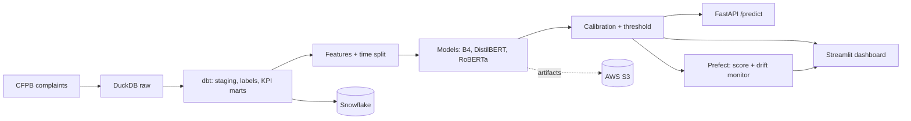

# BankSight: Consumer Complaint Intelligence Platform

Predicts which US bank complaints are likely to get **relief** from the company, so a review team can read the right ones first.

- **Author:** NIHAR GUDADHE · [LinkedIn]([[FILL]])
- **Live dashboard:**  https://banksight-consumer-complaint-intelligence-platform-moyi7xojmmp.streamlit.app/

---

## 1. The problem ?
- The CFPB (US consumer finance regulator) publishes millions of complaints.
- Reviewers cannot read all of them, so they need a way to prioritise.
- This project scores every complaint with the chance it gets relief (money or an explanation that helps the customer).
- Complaints above a score threshold go to **review first**. The rest go to standard review.

## 2. What I built
| Part | What it does |
|---|---|
| Data warehouse | DuckDB with `raw`, `features`, `analytics` schemas |
| dbt models | Clean staging, labelled complaints, KPI marts, data tests |
| ML + NLP models | Product-rate baseline, TF-IDF logistic (B4), DistilBERT, RoBERTa |
| Calibration | Scores turned into honest probabilities (isotonic) |
| Decision rule | Cost/benefit threshold: flag if score ≥ 0.25 |
| Drift monitor | Weekly/monthly check that new data still looks like training data |
| API | FastAPI service that scores one complaint or a batch |
| Dashboard | Streamlit app: KPIs, model results, drift, live scoring |
| Cloud | S3 for artifacts; same dbt models verified on Snowflake |

## 3. Architecture


## 4. Key decisions
- **Time-based split, not random.** Train < Jul 2025, validation Jul–Oct 2025, test from Nov 2025. Random splits leak the future.
- **Test set sealed.** Opened once, with a lock file. No tuning after seeing it.
- **Champion chosen by a rule fixed in advance.** RoBERTa must beat B4 by +0.01 PR-AUC with a bootstrap interval above 0. It did.
- **PR-AUC as the main metric.** Only about 18% of complaints get relief, so accuracy would mislead.
- **Calibration.** A score of 0.30 should mean roughly 30% really get relief.
- **Fallback.** If RoBERTa is unavailable, the app uses B4 and says so.

## 5. Results (sealed test set)
Base rate of relief: **18.3%**.

| Model | PR-AUC |
|---|---|
| Random guess | 0.183 |
| B4 (TF-IDF + logistic) | 0.378 |
| **RoBERTa (champion)** | **0.403** |

- Gain over B4: **+0.025** (95% CI +0.016 to +0.033).
- After calibration, mean predicted 0.181 vs actual 0.183 (ECE 0.016).
- At threshold 0.25, RoBERTa flags 32% of complaints: precision 0.36, recall 0.63.
- The lowest-scored 10% still contained 2.3% relief cases, so low scores are not a guarantee.
- Relief cases: 18.3%. Flagged: 32.1%.
- True positives = 0.321 × 0.359 precision ≈ 11.5%.
- False positives = 32.1% − 11.5% ≈ 20.6%.
- False negatives = 18.3% − 11.5% ≈ 6.8%.
- Accuracy = 100% − 20.6% − 6.8% ≈ 72.6%.

## 6. Tech stack
- **Language:** Python 3.11
- **Data:** DuckDB, pandas, dbt-duckdb
- **ML / NLP:** scikit-learn, LightGBM, XGBoost, SHAP, Hugging Face Transformers (DistilBERT, RoBERTa), PyTorch
- **Training:** Google Colab (T4 GPU) for fine-tuning; laptop for everything else
- **Serving:** FastAPI, Pydantic, Uvicorn
- **Dashboard:** Streamlit
- **Orchestration / monitoring:** Prefect, PSI drift checks
- **Testing:** pytest
- **cloud:** AWS S3 (boto3), Snowflake (key-pair auth, dbt-snowflake)
- **Packaging:** Dockerfile

## 7. Folder structure
```
BankSight/
├── README.md
├── requirements.txt            # dashboard / app dependencies
├── requirements-api.txt        # API dependencies
├── Dockerfile                  # API image recipe (not built)
├── pytest.ini
├── notebook/                   # step-by-step notebooks (01 to 09)
│   └── colab/                  # notebooks that run on Colab (fine-tuning, predictions)
├── src/banksight/
│   ├── config.py               # paths and constants
│   ├── nlp/                    # text cleaning, PII redaction, topics
│   ├── ml/                     # loader, calibration, scoring
│   ├── monitoring/drift.py     # PSI and drift rules
│   └── api/                    # FastAPI app and schemas
├── pipelines/score_and_monitor.py   # Prefect flow
├── dashboards/app.py           # Streamlit app
├── dbt_banksight/              # dbt project (models, tests, seeds, profiles)
├── cloud/                      # S3 sync, Snowflake load, reconcile
├── tests/                      # unit and API tests
├── reports/                    # KPIs, figures, model results, drift, model card
├── models/                     # trained files (not in git)
└── data/                       # raw and warehouse files (not in git)
```

## 8. How to run it (Windows)
```
python -m venv venv
venv\Scripts\activate
pip install -r requirements.txt
```
Dashboard (reports only works without models):
```
python -m streamlit run dashboards/app.py
```
API (needs the files in `models/`):
```
pip install -r requirements-api.txt
python -m uvicorn banksight.api.main:app --app-dir src
```
Then open `http://127.0.0.1:8000/docs`. Set `BANKSIGHT_USE_ROBERTA=0` to use B4 only.

Tests and monitoring:
```
python -m pytest
python pipelines/score_and_monitor.py build-reference
python pipelines/score_and_monitor.py monitor --all
```
dbt:
```
cd dbt_banksight
dbt build --profiles-dir .
```

## 9. API example
```
POST /predict
{ "narrative": "...complaint text...", "product_group": "Credit card" }
```
Returns: relief probability, review priority (`review_first` or `standard_review`), model used, topic and a notice.

## 10. Data and privacy
- Source: public CFPB consumer complaint database.
- Narratives are redacted for PII before scoring. Raw data and models are not in this repo.
